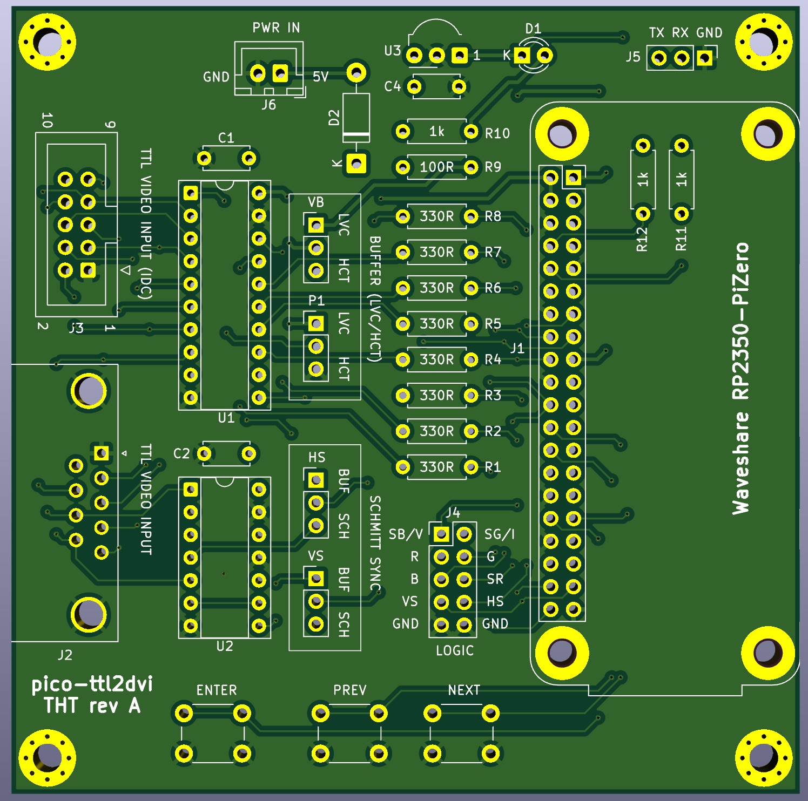
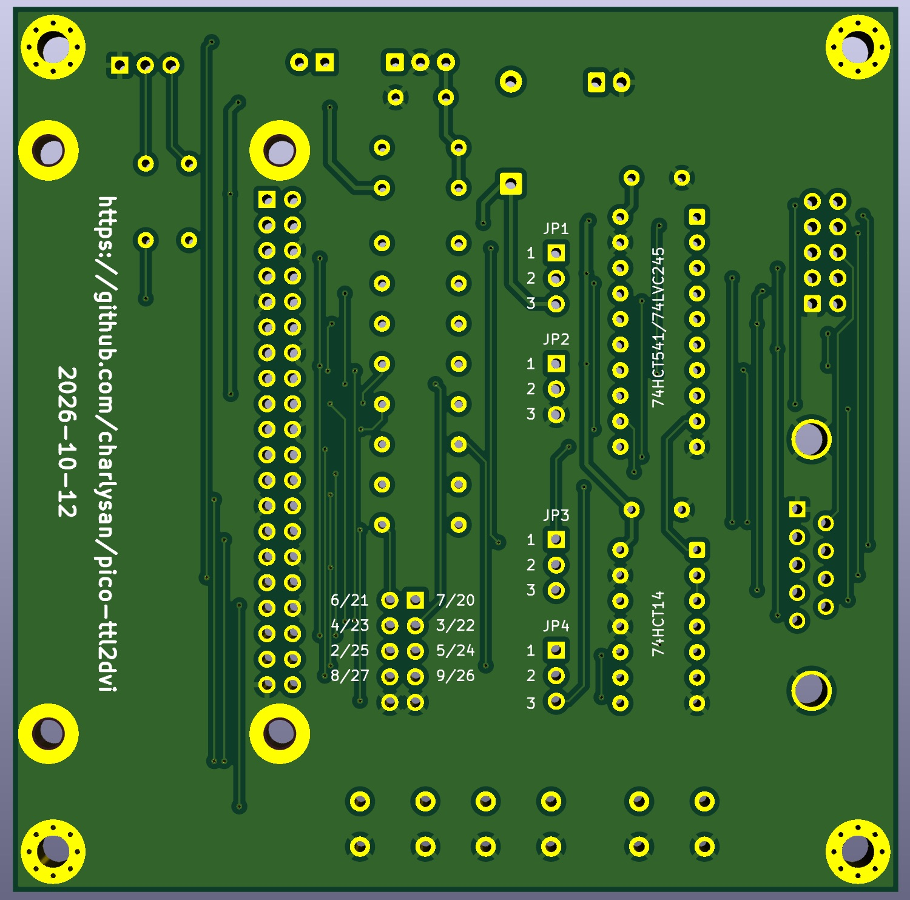
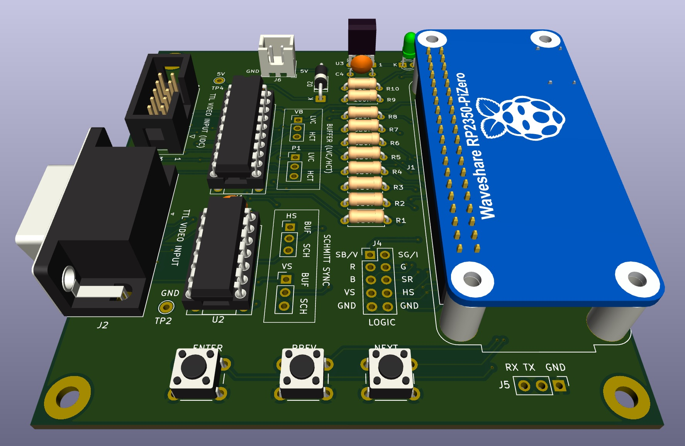

# Hardware

Through-hole adapter board for the [Waveshare RP2350-PiZero](https://www.waveshare.com/wiki/RP2350-PiZero).
It takes the graphics card's TTL video on a DE-9 (or an IDC10 header), buffers it,
and feeds it to the RP2350. The HDMI output is the Waveshare's own mini HDMI.

  
  
  

> **Disclaimer.** Experimental hobby hardware, shared as it is, with no
> warranty. See the [main README](../README.md).

> **Not tested yet.** The rev A board has not been built (yet). The circuit was
> tested on a breadboard prototype (74HCT541 + 330 Ω), not on this PCB.

## Files

Everything for a revision is under `tht/rev<X>/`. For rev A:

| File | What |
|---|---|
| [`gerbers/ttl2dvi_tht_revA.zip`](./tht/revA/gerbers/ttl2dvi_tht_revA.zip) | Gerbers + drill files, ready to upload |
| [`BOM.txt`](./tht/revA/BOM.txt) | Bill of materials, with an "optional" column |
| [`schematic/schematic_tht_reva.pdf`](./tht/revA/schematic/schematic_tht_reva.pdf) | Schematic |
| `ttl2dvi_tht.kicad_*` | KiCad 10 project |

## Ordering the PCB

Upload the gerber `.zip` file as is to your PCB manufacturer (I've used JLCPCB constraints).
`THT` means that every part is through hole, so no assembly service is needed.

## HCT or LVC

U1 (buffer) and U2 (Schmitt) are socketed, and the board takes either logic
family. Pick one family for both chips.

| Build | U1 | U2 | Supply | Notes |
|---|---|---|---|---|
| **HCT** | 74HCT541 | 74HCT14 | 5 V | Keeps the power-sequencing rule (below). |
| **LVC** | 74LVC245A | 74LVC14A | 3.3 V | No power-sequencing rule. |

Both should work. However, I have only tested with HCT. LVC is the better choice if you can
get it though.

**HCT only: power the Pico first, then the PC. Turn the PC off first, then the
Pico.** With LVC the card may be live while the Pico is off.

R1-R8 (330 Ω) are fitted in both builds.

## Jumpers

All four are 1x3 headers. So, you can use a shunt or just solder a jumper.

| Jumper | Sets | 1-2 | 2-3 |
|---|---|---|---|
| JP1 | buffer supply | 3V3 (**LVC**) | 5V (**HCT**) |
| JP2 | U1 pin 1 | DIR, '245 (**LVC**) | /OE1, '541 (**HCT**) |
| JP3 | HSYNC source | U1 buffer | U2 Schmitt |
| JP4 | VSYNC source | U1 buffer | U2 Schmitt |

- JP1 and JP2 always go together: both on LVC, or both on HCT.
- **No U2 fitted: JP3 and JP4 on 1-2.** On 2-3 the syncs come from an empty
  socket and nothing is captured.

## What to populate

You do not need to fit everything. The minimum is:

- J1 (2x20 female header) and the Waveshare module
- J2 (DE-9) **or** J3 (IDC10)
- U1 + socket, C1, C2
- R1-R8
- JP1-JP4 + shunts

The rest is optional. Check the "optional" column in [`BOM.txt`](./tht/revA/BOM.txt).

| Part | What for |
|---|---|
| J3 | Alternative input: a DE9-to-IDC10 cable (IDC pin n = DE-9 pin n). **Use one input only**, never J2 and J3 at once |
| U2 + socket | Schmitt trigger on HSYNC/VSYNC. Not needed so far; added for experimentation when HSYNC is distorted / degraded. |
| SW1-SW3 | PREV / NEXT / ENTER buttons for the on-screen menu  (OSD)|
| U3, R9, C4 | IR receiver for a remote. R9 and C4 are required when U3 is fitted |
| D1, R10 | IR activity LED, for debugging |
| J4 | Logic analyser header (GPIO 20-27 + GND) |
| J5, R11, R12 | Serial console pins. R11/R12 sit under the module. |
| J6, D2 | External 5 V input |

## Mounting the Waveshare

The module plugs in **face down**: component side towards the adapter board,
with its USB-C and mini HDMI at the board edge. Its BOOT and RUN buttons are
not reachable that way. Use `picotool reboot -f -u`, the `bootsel` console
command, or hold **ENTER + NEXT** for 2 s to get into BOOTSEL.

## Power

Power the board from **either** the Waveshare's USB-C **or** J6 (5V IN).

> **NEVER connect J6 and a USB-C cable at the same time.** The 5 V pins on
> the header are the Waveshare's USB VBUS. D2 stops USB from feeding the
> external supply, but not the other way round!

Never feed anything into a 3V3 pin.
